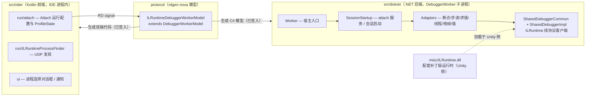

# ILRuntime2Rider

[](https://github.com/Koyoter/ILRuntime2Rider/actions/workflows/CI.yml)


将 Rider 调试器附加到运行 [ILRuntime](https://github.com/Ourpalm/ILRuntime) 热更 DLL 的 Unity 游戏，支持断点、单步和变量检查。

## 安装

插件未上架 JetBrains Marketplace，从 [GitHub Releases](https://github.com/Koyoter/ILRuntime2Rider/releases) 下载与 Rider 大版本匹配的 zip，然后在 Rider 中：`Settings → Plugins → ⚙ → Install Plugin from Disk...`。

## 使用

1. Unity 游戏运行带调试服务的 ILRuntime（宿主进程会在 UDP 56000 上广播自己的调试端口）
2. 打开 Unity 工程对应的 Rider 解决方案，运行配置里已自动生成 **Attach To ILRuntime**
3. 点击 Debug，弹出进程选择对话框，从自动发现的列表中选择目标宿主
4. 在热更 C# 源码上设置断点，F10 / F11 单步，变量窗口展开对象，监视窗口输入表达式（含方法调用）

**附加会话内，Unity 侧调试服务因热更域重载等原因断开后，再次运行时会重新广播，插件自动重新挂上调试，无需手动重新附加。**

## 工作原理

```
Rider IDE                         DebuggerWorker 子进程                Unity 游戏进程
┌─────────────────────┐   RD    ┌──────────────────────────┐  TCP   ┌───────────────────┐
│ Kotlin 前端          │ ──────► │ 协议适配层                 │ ─────► │ ILRuntime          │
│ · attach 运行配置    │ ILRuntime│ · 断点绑定/步进/变量求值    │ ILRuntime│ · ILIntepreter     │
│ · UDP :56000 进程发现 │ StartInfo│ · Roslyn 解析断点/表达式   │ 线协议   │ · DebuggerServer   │
│ · 进程选择对话框      │         │ · 线协议客户端(DebugSocket)│ ◄───── │  (调试线协议服务端)  │
└─────────────────────┘         └──────────────────────────┘ 事件    └───────────────────┘
```

一次附加的完整链路：

1. **发现**：Unity 宿主进程在 UDP 56000 广播（项目名、机器名、PID、调试端口）；前端 `ILRuntimeProcessFinder` 常驻监听并累积进程列表
2. **附加**：用户从 `ILRuntimeProcessSelectionDialog` 选中进程后，`ILRuntimeAttachProfileState` 启动 .NET DebuggerWorker 子进程，经 RD 协议下发 `ILRuntimeStartInfo {host, port, projectName}`
3. **握手**：worker 用 `DebugSocket` 连接 ILRuntime DebuggerServer，校验调试协议版本
4. **断点绑定**：Rider 中设置的断点由 worker 用 Roslyn 重新解析源文件，生成 `CSBindBreakpoint`（类型 / 方法 / 命名空间 / using 集合）发送给服务端
5. **运行时事件回传**：`SCBreakpointHit` / `SCStepComplete` / 线程生命周期 / 变量求值结果，经适配层映射回 Rider 调试器 UI

线协议必须与 ILRuntime 调试服务端保持字节兼容，协议编解码集中在 `SharedDebuggerCommon.DebuggedProcess`。

## 架构与目录结构



```
├── protocol/                                  # RD 模型 nova 定义（rdgen 输入）
│   └── src/main/kotlin/model/debuggerWorker/ILRuntimeDebuggerWorkerModel.kt
├── src/rider/main/
│   ├── kotlin/                                # IDE 前端：attach 配置、UDP 发现、选择 UI
│   ├── kotlin262/ / kotlinPre262/             # 按 Rider wave 选择的 AttachProfileState 变体（2026.2 移除了 createDebuggerWorker 钩子）
│   └── resources/META-INF/plugin.xml
├── src/dotnet/ReSharperPlugin.ILRuntime2Rider/
│   ├── Rider/DebuggerWorker/
│   │   ├── Worker/                            # worker 宿主入口与调试器类型注册
│   │   ├── SessionStartup/                    # attach 服务、调试会话启动信息
│   │   ├── Adapters/                          # 按调试器适配面组织：断点/步进/求值/元数据/线程/栈帧/值
│   │   ├── SharedDebuggerCommon/              # ILRuntime 调试线协议客户端（DebuggedProcess、断点基类）
│   │   ├── SharedDebuggerImpl/                # 线程/栈帧/值工厂 shim 与元数据 Lite 视图
│   │   └── Model/DebuggerWorker/              # rdgen 生成的 C# 模型（已签入）
│   ├── misc/                                  # 配套补丁版 ILRuntime.dll / ILRuntime.Mono.Cecil.dll（Unity 侧须使用此构建）
│   └── Tests/                                 # dotnet 单元测试
├── .github/workflows/CI.yml                   # PR smoke 构建 + tag 驱动的多版本 Release 矩阵
└── build.gradle                               # gradle-intellij-platform 2.x + rdgen 2026.2.5
```

两端生成代码（`ILRuntimeDebuggerWorkerModel.Generated.kt` / `.cs`）已签入仓库，模型改动后需手动执行 `rdgen` 重新生成。

## 构建与开发

依赖：JDK 17、.NET SDK（版本见矩阵）、Windows（CI 与 MSBuild 定位按 Windows 校验）。

```powershell
./gradlew buildPlugin        # 产出 output/*.zip 与 *.nupkg
./gradlew runIde             # 沙箱内启动一个带插件的 Rider 实例
./gradlew testDotNet         # dotnet 单元测试
./gradlew rdgen              # 修改 RD 模型后重新生成双端代码（手动步骤）
```

> 首次构建时 Gradle 会在配置期下载整个 Rider IDE（约 3 GB）。若本地已有解压好的 Rider，可传 `-PLocalRiderHome=<Rider 解压目录>` 走零网络配置；默认目标版本由 `gradle.properties` 的 `ProductVersion` 控制。

### CI 与多版本发布

- PR / 分支推送触发 smoke 构建；`main` 分支提交不触发
- 推送 `v*` tag 触发 Release 矩阵：每个 Rider 大版本独立出一个 zip（版本号 = tag 剥 `v` 前缀），并自动创建 GitHub Release 上传产物

| Rider | since/until | dotnet SDK |
|---|---|---|
| 2024.3 | 243 / 243.* | 2024.3.8 |
| 2025.1 | 251 / 251.* | 2025.1.0 |
| 2025.2 | 252 / 252.* | 2025.2.0 |
| 2025.3 | 253 / 253.* | 2025.3.0 |
| 2026.1 | 261 / 261.* | 2026.1.0 |
| 2026.2 | 262 / 262.* | 2026.2.0 |

各版本的协议漂移由 rdgen 按对应 SDK 重新生成吸收；仅当出现源码级差异 API 时才引入版本目录（现有唯一一处：`kotlin262/` vs `kotlinPre262/`）。

## 许可证

[GPL-3.0](LICENSE)。
